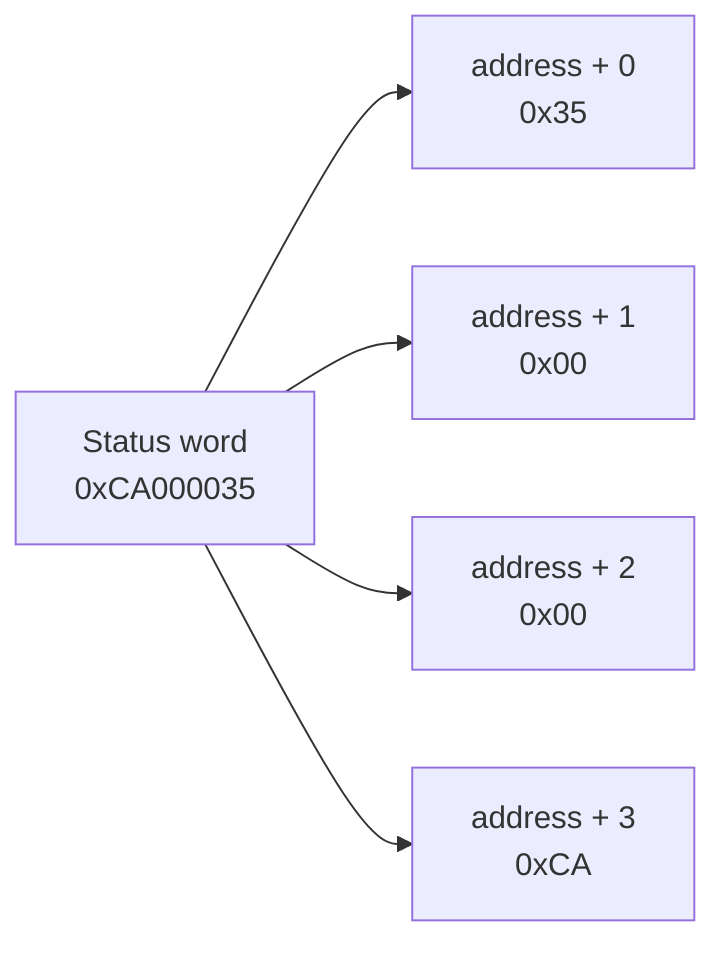

# Phase README — Pre-flight

> **Phase 00 — Bits, bytes and memory addresses** | Canary · Bare-Metal Programming

On the way down, you learn to read and change individual bits of a word in memory, at an address you can see.

Canary is still sealed inside its drop pod, falling towards the planet. Nothing is wired up and there is no light to switch on; the only thing on board you can see is the flight computer's memory, through the debugger. The flight computer records the whole descent in a single 32-bit **status word**: one bit for each event (heat shield gone, parachute out, legs extended), a small two-bit field for the descent stage, and the pod's ID in the top byte. Your job in this phase is to keep that word up to date as the descent happens, changing exactly the bits you mean to and nothing else.

That might sound like a warm-up, but it is the whole of bare-metal programming in miniature. In the next phase you'll meet the chip's **registers**, and a register is nothing more than a 32-bit word at a fixed address, where each bit (or small group of bits) controls a piece of hardware. If binary, hex, addresses and masks still feel shaky when you get there, every line of phase 1 becomes guesswork, because you'd be learning the hardware and the bit-twiddling at the same time. Here you learn the bit-twiddling on a harmless word in memory, where a mistake costs nothing.

> **A note on scope.** Nothing happens on the board in this phase: no LED, no wiring. Everything you do, you watch in the debugger. The startup file and linker script also run before `main`. The linker script is what decides where in memory your status word ends up, and you'll look at it properly in phase 12. The build's *"FPU is not initialized"* warning is expected and harmless.

---

## 🗺️ Contents

- [Branch sequence](#-branch-sequence)
- [Solutions to previous challenges and thought pieces](#-solutions-to-previous-challenges-and-thought-pieces)
- [Why we made this decision](#-why-we-made-this-decision)
- [What we built in the previous branch](#-what-we-built-in-the-previous-branch)
- [What we're doing in this branch](#-what-were-doing-in-this-branch)
- [The abstraction we earned](#-the-abstraction-we-earned)
- [Learning goals](#-learning-goals)
- [Key concepts](#-key-concepts)
- [What to notice in the code](#-what-to-notice-in-the-code)
- [Running this branch](#-running-this-branch)
- [Challenges for students](#-challenges-for-students)

---

## 📍 Branch sequence

| Branch | What it introduces | Abstraction level |
|---|---|---|
| `main` | Blank STM32CubeIDE project — builds, flashes, runs an empty superloop | Scaffold only |
| `📌 phase-00_pre-flight_bits-and-addresses` | **Binary and hex · bytes, half-words and words · memory addresses and little-endian · pointers from addresses · set, clear, toggle, test and bit fields** | Named bit masks |
| `phase-01_first-light_registers` | Datasheet and memory map · registers via hand-written macros · RCC clock enable · blinking the landing beacon | Raw register addresses |
| `phase-02_status-lights_cmsis-bsrr` | Register structs · vendor device header · SAFE / CAUTION / HAZARD lights · atomic set/reset (BSRR) | Register structs |
| `phase-03_arming-button_gpio-input` | Button input · pull-ups · active-low · edge detection · debounce | — |
| `phase-04_uplink-telemetry_uart-tx` | Serial communication · UART framing · UART transmit driver · `printf` over the uplink | — |
| `phase-05_uplink-commands_uart-rx` | UART receive · command interpreter | — |
| `phase-06_sensor-bus_spi-i2c` | SPI · I²C *(to be designed)* | — |
| `phase-07_surface-sensors_adc` | ADC concepts · ADC driver · temperature and pressure · first safety verdict | — |
| `phase-08_precise-timing_systick` | SysTick · exact millisecond delays · precise beacon pattern | Calibrated delays |
| `phase-09_mission-clock_timers` | General-purpose timer · prescaler and auto-reload · 1 Hz telemetry | — |
| `phase-10_hardware-beacon_output-compare-pwm` | Output compare · PWM · night-mode dimming | Hardware-driven output |
| `phase-11_radiation-counter_input-capture` | Input capture · measuring a pulse rate | — |
| `phase-12_hazard-button_interrupts` | Interrupts · NVIC · vector table · what runs before `main` · EXTI button | Interrupt-driven |
| `phase-13_uplink-interrupts_ring-buffer` | Interrupt-driven UART · ring buffer · sharing data safely | — |
| `phase-14_mission-tick_nonblocking` | SysTick, timer and ADC interrupts · non-blocking timing | Tick-based scheduling |
| `phase-15_driver-layers` | Driver APIs · register / driver / application layers | Driver layer |
| `phase-16_vendor-hal` | Vendor HAL · clock tree and PLL · tracing HAL calls to registers | Vendor HAL |
| `phase-17_probe-modes_state-machines` | Finite state machines · probe modes · the limits of the superloop | State machines |

---

## ✅ Solutions to previous challenges and thought pieces

This is the first phase, so there is nothing to resolve yet. From phase 1 onwards, this section answers the previous phase's analytical challenges and thought pieces, and the first commit on each branch (`SOLUTION: …`) contains the code for its additive challenges.

---

## 💡 Why we made this decision

### Learn on memory you can see, before hardware you can't

You could learn bit manipulation on a laptop with `printf`. But on the probe there is no screen and, so far, no serial link, and in the next phase the words you change won't be variables — they'll be hardware registers, where a wrong bit can switch off the debugger's own connection to the chip. So this phase sits in between: a real word in the chip's real memory, watched through the same debugger you'll use for every phase after this one, where getting a bit wrong breaks nothing. It also gets you comfortable with the debugger's views now, while there's nothing else to learn at the same time.

### Count in hex, because the documents do

Underneath, everything in the chip is binary: each **bit** is a 0 or a 1, and a 32-bit word is 32 of them in a row, numbered from **bit 0** on the right (the least significant) to **bit 31** on the left. Binary is exact but unreadable — `11001010000000000000000000110101` is the probe's status word after touchdown. Decimal hides the bits entirely: the same value is 3,388,997,685, and there is no way to see from that which flags are set.

**Hexadecimal** is the compromise every datasheet uses, because each hex digit stands for exactly four bits. So you can convert a word one digit at a time, without arithmetic:

| Hex digit | `C` | `A` | `0` | `0` | `0` | `0` | `3` | `5` |
|---|---|---|---|---|---|---|---|---|
| Bits | 31–28 | 27–24 | 23–20 | 19–16 | 15–12 | 11–8 | 7–4 | 3–0 |
| Binary | `1100` | `1010` | `0000` | `0000` | `0000` | `0000` | `0011` | `0101` |

Reading `0xCA000035` right to left, the last digit `5` (`0101`) tells you bits 0 and 2 are set, and the `3` (`0011`) tells you bits 4 and 5 are set. That's how you'll read every register value in this repo.

The status word is laid out like this. It's the same kind of table the reference manual draws for every register:

| Bits | Name | Meaning |
|---|---|---|
| 31–24 | Pod ID | `0xCA` — written by the ship before the drop ("CA" for Canary) |
| 23–8 | — | Unused, always 0 |
| 7 | Heartbeat | Toggled forever once the probe has landed, to show it is still running |
| 6 | — | Unused |
| 5–4 | Descent stage | A two-bit field: `00` orbit, `01` entry, `10` descent, `11` landed |
| 3 | — | Unused |
| 2 | Legs extended | Set when the landing legs are out |
| 1 | Parachute out | Set when the parachute opens, cleared when it is cut away on touchdown |
| 0 | Heat shield jettisoned | Set when the heat shield drops away |

### Bits mean whatever we agree they mean

A bit is just a 0 or a 1. On its own it means nothing. Its meaning comes from a table like the one above, which says what each bit stands for. That table is how we give meaning to the status word. Nothing in the chip knows that bit 1 is the parachute: we decided it, and the code follows that decision.

So treat the status word as the Canary probe's own custom register. For now it's an ordinary variable in SRAM, and its bits mean only what our table says. From phase 1 on, you'll work with the chip's hardware registers. They work the same way, with one difference: their bits are wired to circuits, so setting a bit makes something happen.

Bits carry meaning in two ways. A **flag** is a single bit that answers one yes/no question, like "is the parachute out?". The probe's three flags take three bits, and any mix of them can be set at once. A **field** is a group of bits that together pick one value from a list. Two bits give four values (`00`, `01`, `10`, `11`), three give eight, and *n* bits give 2ⁿ. The descent stage is a field because the probe is only ever in one stage at a time.

Text is bits too: ASCII is a table that gives each character its own byte. Store the descent stage as the word `"descent"` and it takes eight bytes of memory, 64 bits. As a field it takes two. The pod ID shows the same thing from the other side. `0xCA` is one byte holding the number 202, and it only *looks* like "CA" because hex uses letters for the digits 10 to 15. The text `"CA"` would be two different bytes, `0x43 0x41`.

### Memory is a row of numbered bytes

The chip's memory is a long row of **bytes** (8 bits each), and every byte has its own number: its **address**. On the STM32F411, the 128 KB of SRAM where your variables live starts at address `0x2000 0000`. A 32-bit word doesn't fit in one byte, so it takes four bytes at four consecutive addresses. You name the word by the address of its first byte.

Which byte goes first? The Cortex-M4 is **little-endian**: the *least* significant byte goes at the lowest address. So when you look at the status word in the debugger's memory view, the pod ID `0xCA` — the top byte — appears *last*, not first:

An address is just a number. C lets you take a variable's address with `&`, store it in an ordinary integer, and turn that integer back into a pointer — and once you have a pointer, reading or writing through it reads or writes those bytes of memory. You can even point at the same address with different pointer types: as one 32-bit word (`uint32_t`), as two 16-bit half-words (`uint16_t`) or as four separate bytes (`uint8_t`). This is the move phase 1 makes with the chip's registers, except that there you'll take the number from the datasheet instead of from `&`.

### Change only the bits you mean to

The status word holds several pieces of information at once, so you can almost never write the whole word. Writing `=` replaces all 32 bits: set the parachute flag that way and you've also wiped the pod ID, the stage and every other flag. Instead, every update reads the word, changes some bits and writes it back, using a **mask** (a value with only the bits you care about set):

| Operation | Operator | What it does |
|---|---|---|
| **Set** a bit | `\|=` mask | Forces the masked bits to 1, leaves the rest alone |
| **Clear** a bit | `&= ~`mask | Forces the masked bits to 0, leaves the rest alone |
| **Toggle** a bit | `^=` mask | Flips the masked bits, leaves the rest alone |
| **Test** a bit | `&` mask, compared with 0 | Tells you whether the masked bits are set, changes nothing |

A **field** of more than one bit, like the descent stage, needs two steps: clear the whole field, then set the new value shifted into position. If you skip the clear, the old and new values get mixed together. Moving from entry (`01`) to descent (`10`) by setting bits alone gives you `11`, so the flight computer would record a landing while the probe is still on its parachute.

### Name your bits

There are three ways to write "set the parachute flag", and they all produce exactly the same machine code:

| Style | How it looks | What you have to know to read it |
|---|---|---|
| Raw hex | `*status \|= 0x00000002;` | That `0x2` means bit 1, and that bit 1 is the parachute |
| Shift | `*status \|= (1U << 1);` | That bit 1 is the parachute |
| Named mask | `*status \|= PARACHUTE_OUT;` | Nothing — it says what it does |

The code in this phase uses named masks, built from shifts in one place at the top of the file. It is still a lot of manual work: every bit needs its own `#define`, and every position has to be looked up and typed correctly. Keep an eye on that cost — in phase 1 you do the same for real hardware registers, and in phase 2 you'll see how the industry cuts it down.

---

## ⏮️ What we built in the previous branch

`main` left you a freshly generated STM32CubeIDE project for the STM32F411RE: a startup file, linker scripts, and a `main.c` containing nothing but an empty `while (1)` loop. It builds, flashes and runs, but does nothing you can see. The CPU is running and the memory is there; nothing in your code uses either yet.

---

## 🎯 What we're doing in this branch

- **`Src/main.c` — the status word:** a `volatile uint32_t descent_status` in SRAM, starting as `0xCA000000` (the pod ID in the top byte, everything else 0).
- **`Src/main.c` — named masks:** a `#define` for each flag and for the descent-stage field, built from `1U << n` shifts, so no raw hex appears in the logic.
- **`Src/main.c` — from address to pointer:** take the status word's address with `&`, keep it as a plain number, and turn it back into a `uint32_t` pointer that all the updates go through. Then point a `uint16_t` pointer and a `uint8_t` pointer at the same address, to see the word as half-words and bytes.
- **`Src/main.c` — the descent:** a sequence of masked updates you step through in the debugger: set the entry stage, set the heat-shield and parachute flags, change the stage field to descent, set the legs flag, test it to declare landing, clear the parachute flag.
- **`Src/main.c` — the superloop:** toggle the heartbeat bit forever, so the word never stops changing.

---

## 🏆 The abstraction we earned

> Named masks turn the status word from a number you have to decode into a set of named switches. `*status |= PARACHUTE_OUT` says what it does; `*status |= 0x00000002` only says which bit it touches, and you have to remember the rest. Every bit position is written down once, at the top of the file, instead of being retyped (and possibly mistyped) wherever it's used. Phase 1 uses exactly this pattern for the chip's registers — the only new thing there is where the address comes from.

---

## 🧑🏻‍🏫 Learning goals

### Understand
- **Convert** the status word between binary, hex and decimal — for example `0xCA000035` — and explain why the documents use hex: each hex digit is exactly four bits.
- **Identify** which bit positions of the status word hold the heat-shield flag, the descent-stage field and the pod ID, numbering from bit 0 on the right to bit 31 on the left.
- **Describe** memory as a row of numbered bytes, and find where the STM32F411's SRAM, which holds `descent_status`, starts in the address space.
- **Explain** why `*status = PARACHUTE_OUT` would wipe the pod ID and the stage, while `*status |= PARACHUTE_OUT` leaves them alone.
- **Explain** why the status word's address can change when you add a variable to the program, while the address of a hardware register — which you'll meet in phase 1 — never does.

### Apply
- **Read** the same status word as one `uint32_t` word, two `uint16_t` half-words and four `uint8_t` bytes, and say which C type matches each size.
- **Access** the status word through a pointer built from the number in `status_address`, and relate that number to `&descent_status`.
- **Use** `|=`, `&= ~`, `^=` and `&` with `1U << n` masks to set, clear, toggle and test the descent flags.
- **Update** the two-bit descent-stage field by clearing it first, then writing the new stage shifted into position.

### Analyze
- ⚠ **Predict** the four bytes the debugger's memory view shows at the status word's address, and explain why the pod ID `0xCA` appears last.

### Evaluate
- **Compare** a raw hex constant, a shift expression and a named mask for the same update. Which is easier to read, and which makes a mistake easier to miss?

---

## 🔑 Key concepts

| Concept | Plain English |
|---|---|
| **Bit** | One binary digit, 0 or 1 — the smallest thing the chip stores. |
| **Bit position** | A bit's place in a word, counted from bit 0 (rightmost, least significant) to bit 31 (leftmost, most significant). |
| **Binary / hexadecimal** | Base 2 and base 16. One hex digit is exactly four bits, which makes hex the easy way to read and write binary. |
| **Byte / half-word / word** | 8, 16 and 32 bits — `uint8_t`, `uint16_t` and `uint32_t` in C. On a Cortex-M, a *word* is 32 bits. |
| **Address** | The number of a byte in memory. A word occupies four addresses and is named by the first. |
| **SRAM** | The chip's working memory for variables; on the STM32F411 it starts at `0x2000 0000`. Its contents are lost when power goes. |
| **Little-endian** | The least significant byte of a multi-byte value is stored at the lowest address. The Cortex-M4 works this way. |
| **Pointer** | A variable holding an address; reading or writing through it (`*p`) reads or writes the memory at that address. |
| **`uintptr_t`** | An integer type big enough to hold an address, for when you want to treat an address as a plain number. |
| **Bit mask** | A value with only the bits you care about set, like `1U << 1`, used to change those bits and nothing else. |
| **Bit field** | A group of neighbouring bits that together hold one value, like the two-bit descent stage. |
| **Read-modify-write** | Reading a word, changing some of its bits and writing it back. `\|=`, `&= ~` and `^=` all do this. |
| **`volatile`** | Tells the compiler that something outside your code (here, you in the debugger) may read or change this value, so every read and write must really happen. |
| **Memory / Expressions views** | The debugger windows that show the bytes at any address, and the value of any C expression, in hex, binary or decimal. |

---

## 🔍 What to notice in the code

*To be completed once the code is written.*

---

## ▶️ Running this branch

*To be completed once the code is written.*

---

## ✏️ Challenges for students

**Challenge 1 — Analytical: decode the word**
Without the debugger, convert `0xCA000023` to binary and use the layout table in [Why we made this decision](#-why-we-made-this-decision) to say exactly what was happening on the probe at that moment: which flags were set and which stage was it in? Then work out the value of the word once the heartbeat bit is set after landing, in hex and in decimal. Why is hex the only one of the three you'd want to read every day?

**Challenge 2 — Analytical: predict the memory view**
Before you step through the code, write down the four bytes you expect to see at the status word's address — at `+0`, `+1`, `+2` and `+3` — at the very start, and again once the probe has landed. Then step through and check. Also predict what the code's `uint16_t` pointer reads as the *second* half-word (index 1). Explain the answers using the word *little-endian*.

**Challenge 3 — Analytical: the premature landing**
Find the two lines that change the descent stage from entry to descent. Comment out the first one — the clear — and step through again. What stage does the word show while the probe is still hanging under its parachute? Work it out in binary first, then confirm it in the debugger, and explain why a field always needs clearing before you write a new value into it.

**Challenge 4 — Analytical: the `=` dry run**
Change the line that sets the parachute flag from `|=` to `=`, and step over it. What happened to the pod ID, the stage and the heat-shield flag? Explain why. In phase 1, a register will hold the settings for many pins at once, including the pins that keep the debugger connected, and this mistake gets much more expensive there.

**Challenge 5 — Additive: measure the dust**
On touchdown, the probe should record how much dust its landing kicked up: a level from 0 to 7, stored in a new three-bit field at bits 10–8. Add the masks for the field and write a dust level of 5 at touchdown without disturbing any other bit. What is the status word, in hex, once the heartbeat bit is set? Check it in the debugger.

**Challenge 6 — Additive: the moving word**
While debugging, read the address of `descent_status` in the **Expressions** view (type `&descent_status`). Add a `#define` holding that address as a number, and build your status pointer from the `#define` instead of from `&`. Build, run and check that the descent still works. Now add a new variable *above* `descent_status` — for example `volatile uint32_t landing_site = 0x1234;` — then build and run again. What does your pointer point at now, and what happened to `descent_status`'s address? Put the code back to using `&` when you're done.

**Challenge 7 — Analytical: an early look at a precedence trap**
A crew member wants to check that the parachute is *not* out, and writes `if (!*status & PARACHUTE_OUT)`. Work out, step by step, what C actually evaluates first — look up the precedence of `!` and `&` — and what the condition comes out as for every value the status word ever has. Why can it never be true? How would you write it correctly? (You'll meet this exact bug again on a real input pin in phase 3.)

---

## 💭 Thought pieces for the next branch

1. Your status word moved when you added a variable in front of it. The beacon's control register lives at an address that never moves. Why not, and which document would tell you where it is?
2. Every bit you set changed something only in memory, and nothing outside the chip noticed. What would have to sit at the other end of a bit for it to light an LED?
3. You named every mask and built one pointer by hand. How many of those would you need to control all 16 pins of one port, each with a two-bit mode field like the descent stage?

---

*Previous branch: [`main`]*
*Next branch: [`phase-01_first-light_registers`]*
