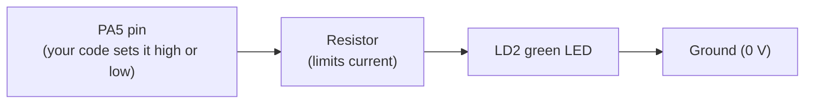
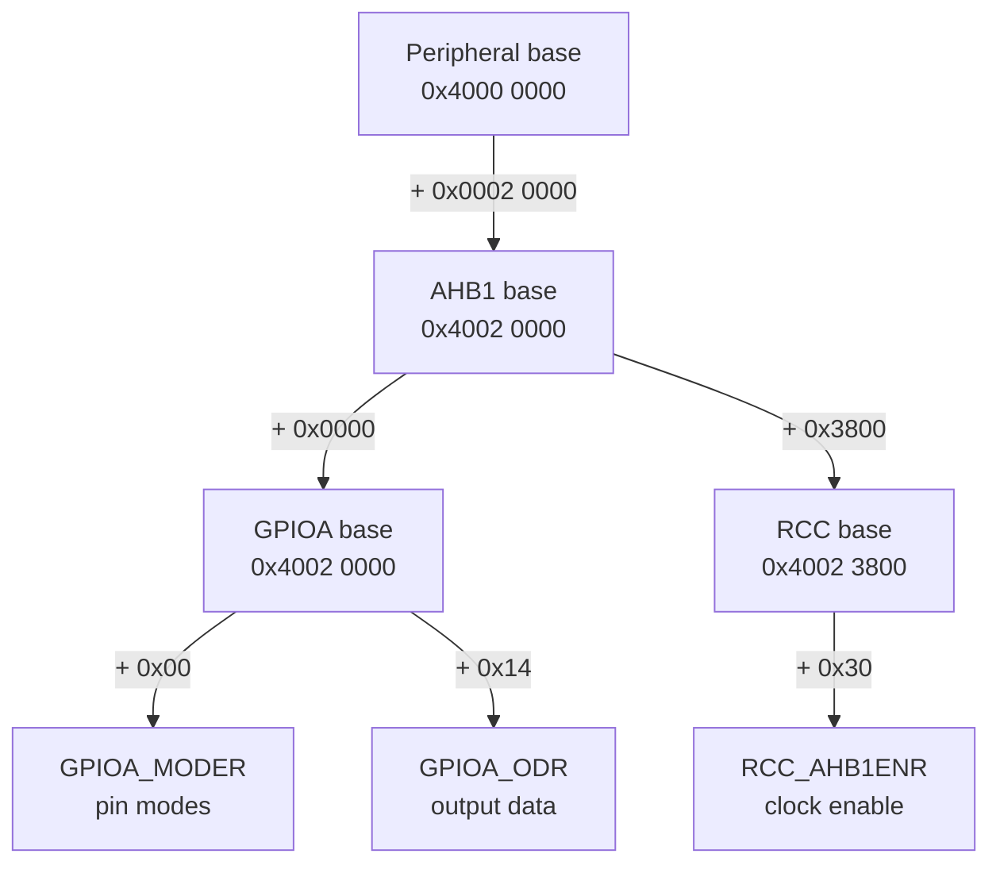
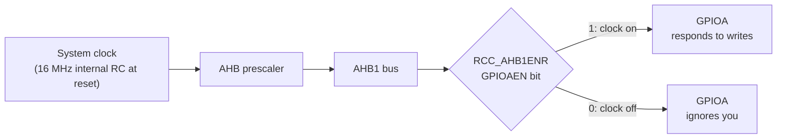

# Phase README — First Light

> **Phase 01 — Bare metal, registers and the first blink** | Canary · Bare-Metal Programming

The probe proves it is alive: you blink its landing beacon by writing directly to the chip's registers.

Canary has just landed. There is no operating system on board, no drivers, no library that knows how to switch on a light — just a microcontroller, a blank `main`, and the documentation ST publishes for the chip. Before the probe can measure anything or talk to the ship, it has to show the crew it survived the landing, and the simplest sign of life is its beacon. Getting that one LED to blink forces you through everything bare-metal programming is built on: finding the hardware in the documents, understanding what a register is, switching a peripheral's clock on, and setting individual bits in C.

Skip this phase and every later one becomes copying magic numbers you don't understand. Every peripheral in this repo — buttons, the uplink, sensors, timers — is brought up with exactly the same routine you learn here: find it in the documents, power it, configure it, drive it.

> **A note on scope.** This is the longest README in the repo, because it lays the groundwork for everything else. You only write a handful of lines of C, but each one needs a document to justify it. The startup file and linker script in the project also run before `main`; you'll take a proper look at them in phase 12. The build's *"FPU is not initialized"* warning is expected and harmless — the chip's floating-point unit isn't used yet.

---

## 🗺️ Contents

- [Branch sequence](#-branch-sequence)
- [Solutions to previous challenges and thought pieces](#-solutions-to-previous-challenges-and-thought-pieces)
- [Why we made this decision](#-why-we-made-this-decision)
- [What we built in the previous branch](#-what-we-built-in-the-previous-branch)
- [What we're doing in this branch](#-what-were-doing-in-this-branch)
- [Learning goals](#-learning-goals)
- [Key concepts](#-key-concepts)
- [What to notice in the code](#-what-to-notice-in-the-code)
- [Running this branch](#-running-this-branch)
- [Challenges for students](#-challenges-for-students)

---

## 📍 Branch sequence

| Branch | What it introduces | Abstraction level |
|---|---|---|
| `main` | Blank STM32CubeIDE project — builds, flashes, runs an empty superloop | Scaffold only |
| `📌 phase-01_first-light_registers` | **Datasheet and memory map · registers via hand-written macros · RCC clock enable · blinking the landing beacon** | Raw register addresses |
| `phase-02_status-lights_cmsis-bsrr` | Register structs · vendor device header · SAFE / CAUTION / HAZARD lights · atomic set/reset (BSRR) | Register structs |
| `phase-03_arming-button_gpio-input` | Button input · pull-ups · active-low · edge detection · debounce | — |
| `phase-04_uplink-telemetry_uart-tx` | Serial communication · UART framing · UART transmit driver · `printf` over the uplink | — |
| `phase-05_uplink-commands_uart-rx` | UART receive · command interpreter | — |
| `phase-06_sensor-bus_spi-i2c` | SPI · I²C *(to be designed)* | — |
| `phase-07_surface-sensors_adc` | ADC concepts · ADC driver · temperature and pressure · first safety verdict | — |
| `phase-08_precise-timing_systick` | SysTick · exact millisecond delays · precise beacon pattern | Calibrated delays |
| `phase-09_mission-clock_timers` | General-purpose timer · prescaler and auto-reload · 1 Hz telemetry | — |
| `phase-10_hardware-beacon_output-compare-pwm` | Output compare · PWM · night-mode dimming | Hardware-driven output |
| `phase-11_radiation-counter_input-capture` | Input capture · measuring a pulse rate | — |
| `phase-12_hazard-button_interrupts` | Interrupts · NVIC · vector table · what runs before `main` · EXTI button | Interrupt-driven |
| `phase-13_uplink-interrupts_ring-buffer` | Interrupt-driven UART · ring buffer · sharing data safely | — |
| `phase-14_mission-tick_nonblocking` | SysTick, timer and ADC interrupts · non-blocking timing | Tick-based scheduling |
| `phase-15_driver-layers` | Driver APIs · register / driver / application layers | Driver layer |
| `phase-16_vendor-hal` | Vendor HAL · clock tree and PLL · tracing HAL calls to registers | Vendor HAL |
| `phase-17_probe-modes_state-machines` | Finite state machines · probe modes · the limits of the superloop | State machines |

---

## ✅ Solutions to previous challenges and thought pieces

This is the first phase, so there is nothing to resolve yet. From phase 2 onwards, this section answers the previous phase's analytical challenges and thought pieces, and the first commit on each branch (`SOLUTION: …`) contains the code for its additive challenges.

---

## 💡 Why we made this decision

### Start from the circuit, not the code

You don't need any electronics background for this repo, but you do need one idea before you write a line of code: **everything a microcontroller pin does, it does by being part of a circuit.**

The green LED on your board, labelled **LD2**, is already wired into a small circuit for you. One end connects to the chip's pin **PA5**; from there the path runs through a resistor (which limits the current so the LED doesn't burn out), through the LED, and on to **ground** — the 0 V reference that every voltage on the board is measured against. Current only flows, and the LED only lights, when there is a voltage difference across that path.

When your code sets PA5 **high**, the pin drives about 3.3 V onto the path: current flows to ground and the LED lights. When your code sets PA5 **low**, the pin sits at 0 V: there is no difference, no current, no light. That is all "turning on an LED" means — your code decides the voltage on one end of a circuit. Every GPIO lesson after this one follows the same pattern: build (or find) a circuit, then control it from a pin.



### Talk to the hardware directly, through addresses

On your laptop, turning something on is a function call into an operating system that talks to a driver that talks to the hardware. Canary has none of those layers. The only way to make the chip do anything is to write the right values into its **registers** — small blocks of memory inside the chip, each 32 bits wide, where every bit controls or reports something about a peripheral.

Those registers live at fixed addresses in the chip's memory map, so your C code reaches them the same way it would reach any memory: through a pointer. In this phase you build those pointers by hand, from base addresses and offsets copied out of the documentation, and wrap them in `#define` macros so the code reads `GPIOA_ODR` rather than a raw hex number. It is deliberately manual. By the end you'll know exactly where every address in the program came from — which is what lets you trust the shortcuts that replace this work in phase 2.

The alternatives — ST's HAL library or a code generator — would make the LED blink sooner, but they would hide the very things this phase is about. You'll meet the vendor HAL in phase 16, when you already know what it does underneath.

### Follow the trail through the documents

Every register address in this phase comes from one of three documents. Each answers a different question (download links are in [`docs/reference/`](docs/reference/README.md)):

| Question | Document | What you find |
|---|---|---|
| Which pin is the beacon LED on? | Nucleo-64 user manual (UM1724), section on LEDs | LD2 is wired to **PA5** — port A, pin 5 |
| Which bus feeds port A, and where do its registers start? | STM32F411 datasheet — block diagram and memory map | GPIOA sits on the **AHB1** bus; peripherals start at `0x4000 0000`, AHB1 at `0x4002 0000`, GPIOA at `0x4002 0000`, RCC at `0x4002 3800` |
| Which bits enable the clock and set the pin's mode and output? | STM32F411 reference manual (RM0383) — RCC chapter and GPIO chapter | `RCC_AHB1ENR` at offset `0x30`, bit 0 `GPIOAEN` · `GPIOx_MODER` at offset `0x00`, bits 11:10 for pin 5 · `GPIOx_ODR` at offset `0x14`, bit 5 |

The address of each register is simply **base + offset**: the peripheral's base address from the datasheet, plus the register's offset from the reference manual. You build that tree of addresses in the code exactly as it appears here:



### Enable, configure, drive — always in that order

Every peripheral on the chip starts switched **off**. To save power, the chip gates (cuts off) the clock to each peripheral until you ask for it through the **Reset and Clock Control (RCC)** block — and a peripheral without a clock simply ignores you. No error, no crash, just nothing. So the beacon needs three steps, in this order:

1. **Enable** — set the `GPIOAEN` bit in `RCC_AHB1ENR` so port A receives a clock.
2. **Configure** — set pin 5's two mode bits in `GPIOA_MODER` to `01`, *general-purpose output*.
3. **Drive** — set or clear bit 5 in `GPIOA_ODR` to put 3.3 V or 0 V on the pin.

Each register holds settings for many pins at once, so every write has to change only the bits you mean to change and leave the others exactly as they were. That is why the code uses bitwise operators (`|=`, `&= ~`, `^=`) with masks rather than plain assignment. Plain assignment overwrites every bit — and on port A, some of those bits keep your debugger connected (challenge 2 shows you what happens when you forget).

---

## ⏮️ What we built in the previous branch

`main` left you a freshly generated STM32CubeIDE project for the STM32F411RE: a startup file, linker scripts, and a `main.c` containing nothing but an empty `while (1)` loop. It builds, flashes and runs — and does absolutely nothing you can see. The board is powered and the CPU is running, but no peripheral has been switched on and no pin is being driven.

---

## 🎯 What we're doing in this branch

- **`Src/main.c` — register macros:** build the address tree by hand — peripheral base, AHB1 base, the GPIOA and RCC bases, then `RCC_AHB1ENR`, `GPIOA_MODER` and `GPIOA_ODR` as `volatile` 32-bit pointers that are dereferenced in the macro.
- **`Src/main.c` — bit masks:** name the bits you touch (`GPIOAEN`, the beacon pin) instead of scattering raw shifts through the code.
- **`Src/main.c` — enable → configure:** switch on port A's clock in the RCC, then set PA5 to general-purpose output using masked writes that leave every other pin untouched.
- **`Src/main.c` — the superloop:** toggle the beacon forever, with a busy-wait delay loop between toggles so the blink is slow enough to see.

---

## 🧑🏻‍🏫 Learning goals

### Understand
- **Explain** what bare-metal programming is — why Canary's firmware talks to registers directly instead of asking an operating system — and how that differs from the programs you write on your laptop.
- **Describe** why almost every electronic device around you — a washing machine, a car key, this probe — is built around a microcontroller driving peripherals such as lights, sensors and serial links.
- **Identify** the building blocks of the STM32F411 — the Cortex-M4 CPU core, Flash, SRAM, peripherals such as GPIO and the buses that connect them.
- **Describe** the superloop that Canary runs inside `main` and explain why `main` never returns on a bare-metal system.
- **Distinguish** what the Nucleo user manual, the datasheet and the reference manual each tell you when you bring up the beacon.
- **Explain** what a register is, and how GPIOA and the RCC expose their configuration and status through registers.
- **Recognise** `GPIOA_MODER`, `GPIOA_ODR` and `RCC_AHB1ENR` as 32-bit memory-mapped locations at specific hex addresses.
- **Explain** why the register macros use `volatile`, and what the compiler might do to a register access without it.
- **Explain** the reset value of `GPIOA_MODER`, and why changing pin 5's mode must leave the other pins' bits untouched.
- **Explain** why port A ignores you until its clock is enabled through the RCC.
- **Describe** how the chip's system clock reaches GPIOA through the AHB bus and its prescaler.
- **Explain** what "general purpose" means for GPIO, and how pins are grouped into ports and numbered (PA5 is port A, pin 5).
- **Differentiate** PA5's default GPIO function from the alternate functions the same pin can take on later (a UART line, an ADC input, a timer channel).
- **Explain** the purpose of the mode, output data and input data registers of a GPIO port.

### Apply
- **Calculate** the address of `RCC_AHB1ENR`, `GPIOA_MODER` and `GPIOA_ODR` from the base addresses in the datasheet and the offsets in the reference manual.
- **Define** each register in C by casting its address to a `volatile uint32_t` pointer and dereferencing it inside a macro.
- **Implement** the beacon's register access with hand-written base/offset macros, one level of the address tree at a time.
- **Use** `|=`, `&= ~`, `^=` and `1U << n` masks to set the clock-enable bit, write pin 5's two-bit mode field and toggle the beacon.
- **Configure** PA5 as a push-pull output and drive the beacon high and low through `GPIOA_ODR`.
- **Implement** the enable → configure → drive sequence that brings the beacon to life from a blank project.

### Analyze
- **Navigate** the datasheet's memory map to find where GPIOA's and the RCC's registers start.
- **Locate** the beacon LED (LD2) and its port and pin in the Nucleo user manual.
- **Trace** GPIOA from the datasheet's block diagram to its bus, its clock-enable bit in the RCC and its registers in the reference manual.
- **Interpret** the reference manual's register diagrams for `RCC_AHB1ENR`, `GPIOA_MODER` and `GPIOA_ODR` — bit positions, field widths, reset values and access types.
- **Distinguish** the AHB and APB buses, and identify which one feeds GPIOA.
- **Diagnose** a beacon that silently stays dark because port A's clock was never enabled.
- **Diagnose** what goes wrong when `GPIOA_MODER` is written with `=` instead of a masked update.

### Evaluate
- **Contrast** the STM32F411 with your laptop's CPU in integration, resources and determinism.
- **Justify** why a probe that must flash a beacon on time, with nobody around to restart it, is a good fit for bare-metal firmware.
- **Compare** the chip's clock sources — the internal RC oscillator, an external crystal and the PLL — by precision and flexibility.

---

## 🔑 Key concepts

| Concept | Plain English |
|---|---|
| **Bare metal** | Your code runs directly on the chip, with no operating system in between — if something needs doing, your code does it. |
| **Microcontroller (MCU)** | A whole small computer on one chip: CPU, Flash for the program, SRAM for data, and peripherals, all wired together. |
| **Peripheral** | A block of hardware inside the MCU that does one job — GPIO, a UART, an ADC, a timer. |
| **Superloop** | The `while (1)` loop in `main` that runs forever; there is no operating system to return to, so `main` never ends. |
| **Register** | A 32-bit location inside a peripheral; writing its bits configures the peripheral, reading them tells you its state. |
| **Memory-mapped I/O** | Registers have ordinary memory addresses, so a pointer write in C is a hardware command. |
| **Base address + offset** | A peripheral's registers start at its base address; each register sits a fixed offset from that base. |
| **`volatile`** | Tells the compiler "this value can change behind your back — always really read and write it". |
| **Bit mask** | A number with only the bits you care about set (like `1U << 5`), used to change those bits and nothing else. |
| **Reset value** | What a register contains when the chip powers up, before your code touches it — listed with every register in the reference manual. |
| **Clock gating** | Peripherals are unclocked (off) by default to save power; the RCC switches each one on. |
| **RCC (Reset and Clock Control)** | The peripheral that hands out clocks and resets to all the other peripherals. |
| **AHB / APB buses** | The internal roads between the CPU and the peripherals: AHB is the fast one (GPIO lives here); APB buses are slower and carry peripherals like the UARTs and timers. |
| **Clock source** | Where the chip's timing comes from: a built-in RC oscillator (always there, less precise), an external crystal (precise) or the PLL (multiplies a source up to a higher speed). |
| **GPIO port and pin** | Pins are grouped into ports A, B, C…; `PA5` means port A, pin 5. |
| **Alternate function** | Most pins can be handed to another peripheral (a UART, an ADC, a timer) instead of plain on/off use. |
| **MODER / ODR / IDR** | A GPIO port's mode register (input, output, alternate, analog), output data register (what you drive) and input data register (what the pin reads). |
| **Push-pull output** | The pin actively drives both high (3.3 V) and low (0 V) — the default, and what the beacon uses. |



---

## 🔍 What to notice in the code

**[`Src/main.c`](Src/main.c) — the address tree**
The first block of macros rebuilds the datasheet's memory map one level at a time: peripheral base, then the AHB1 bus, then GPIOA and the RCC as offsets from it. Each base is built from the one above, so a typo in one place can't quietly disagree with another. Compare each value with the trail table in [Why we made this decision](#-why-we-made-this-decision).

**[`Src/main.c`](Src/main.c) — the register macros**
`RCC_AHB1ENR`, `GPIOA_MODER` and `GPIOA_ODR` each turn an address into `*(volatile uint32_t *)(...)`: cast to a pointer to a 32-bit value the hardware may change, then dereference it. That is why the rest of the code can write `GPIOA_ODR ^= BEACON_PIN` as if `GPIOA_ODR` were an ordinary variable. In phase 2 these hand-built macros get replaced, so look closely at what they do now.

**[`Src/main.c`](Src/main.c) — the bit masks**
`GPIOAEN`, `BEACON_PIN` and the two `BEACON_MODE_BIT` masks give a name to every bit the code touches. Pin 5's mode field is *two* bits wide (11:10), which is why there are two mode masks and two writes: one `|=` to set bit 10, one `&= ~` to clear bit 11. Every other pin's mode bits — including the debugger's on PA13 and PA14 — are left exactly as they were.

**[`Src/main.c`](Src/main.c) — enable, configure, drive**
The three numbered comments in `main` follow the order from [Why we made this decision](#-why-we-made-this-decision): clock first, then mode, then output. The `// NOTE:` explains why there is no write for push-pull — the output type register already resets to push-pull. Inside the superloop, `^=` flips bit 5 of the output data register on every pass.

**[`Src/main.c`](Src/main.c) — the delay**
The empty `for` loop marked `DELIBERATE` is the beacon's only sense of time: the CPU counts to `BEACON_DELAY_COUNT` and does nothing else. The counter is left as a plain variable on purpose — challenge 6 shows you what the compiler does with it. This loop is replaced by a real timer in phase 8.

**[`Startup/startup_stm32f411retx.s`](Startup/startup_stm32f411retx.s)** and the linker scripts are untouched. They run before `main` and decide where your code lives in memory; you'll read them properly in phase 12.

---

## ▶️ Running this branch

You only need the Nucleo board and its USB cable — no breadboard yet.

```
git checkout phase-01_first-light_registers
```

1. In STM32CubeIDE, select the `canary` project and press **F5** (Refresh) so it picks up the branch's files. (First time? See *Build, flash and debug* in the README on `main`.)
2. **Build** (hammer). Expect one warning — *"FPU is not initialized…"* — and no errors.
3. **Run** (green play button) with the board connected. The green LED **LD2** starts blinking — roughly once or twice a second.
4. To watch the registers change, click **Debug** instead, open **Window → Show View → SFRs**, expand **RCC → AHB1ENR** and **GPIOA → MODER / ODR**, and step over each line in `main` with **F6**. You'll see `GPIOAEN` set, pin 5's mode become `01`, and `ODR5` flip on every pass of the loop.

---

## ✏️ Challenges for students

**Challenge 1 — Analytical: the silent beacon**
Comment out the line that enables port A's clock, then build, flash and run. Before you do, predict what will happen. Then start a debug session, open the **SFRs** view, expand **GPIOA** and step over the lines that write `GPIOA_MODER` and `GPIOA_ODR`. What do the registers show? Explain, in terms of clock gating, why the code runs without any error but the beacon never lights.

**Challenge 2 — Analytical: the `=` trap**
Look up the reset value of `GPIOA_MODER` in the reference manual and work out, bit by bit, which pins of port A are *not* plain inputs when the chip starts. Then predict what this line would do to them: `GPIOA_MODER = (1U << 10);`. Pins PA13 and PA14 carry the debugger's connection to the chip (SWD). What happens to your ability to flash and debug the board if their mode bits are cleared? Explain why the masked version in the code avoids the problem.
> ⚠️ If you try it on the board, CubeIDE may lose its connection. To recover, hold the black **RESET** button while you start a flash, or set the debug configuration's reset behaviour to **Connect under reset**.

**Challenge 3 — Additive: give the beacon a character**
Real beacons don't just blink — they flash a pattern so they can be recognised. Change the beacon to flash **twice quickly, then pause** for longer, and repeat. Use `|=` to switch it on and `&= ~` to switch it off instead of toggling with `^=`, so you control each state explicitly.

**Challenge 4 — Analytical: find the arming button**
In phase 3 the crew will arm the probe with the blue user button. Without writing any code, follow the document trail for it: find the button's port and pin in the Nucleo user manual, which bus that port sits on, its clock-enable bit in `RCC_AHB1ENR`, its port's base address, and the full address of that port's **input data register**. Which bits of that port's `MODER` would configure the button's pin, and to what value?

**Challenge 5 — Analytical: why bare metal?**
Your laptop's CPU is far more powerful than the STM32F411. List three things the F411 has *on the same chip* that your laptop's CPU relies on separate chips or an operating system for. Then argue: why would you run Canary's beacon on bare metal rather than on a small Linux computer? Think about how quickly it starts, what happens when nobody is around to restart it, and whether the beacon flashes *on time*.

**Challenge 6 — Analytical: the speeding beacon**
The project builds with the compiler's optimisation switched off. Turn it on: open the project's **Properties → C/C++ Build → Settings → MCU GCC Compiler → Optimization**, set the level to **Optimize more (-O2)**, then build and flash. You haven't changed a line of code — so why does the beacon blink at a different speed? (Hint: open `Debug/canary.list` before and after, find the delay loop, and count its instructions.) Then add `volatile` to the loop counter and flash again. What changes, and why does `volatile` still not give the beacon a delay you can predict? One more thing to know: the C standard allows a compiler to delete a loop that has no visible effect at all, and some compilers do — `volatile` is what forbids that. Set the optimisation level back to **None (-O0)** when you're done.

---

## 💭 Thought pieces for the next branch

1. You wrote about a dozen hand-typed macros to reach just three registers. The probe still needs three status lights and an arming button. How many more addresses would you have to look up and type — and how confident would you be that none of them has a typo?
2. The beacon's delay is a loop count picked by trial and error. Would it still take the same time if the chip ran faster, or the compiler optimised harder? (You'll replace it with a hardware timer in phase 8, SysTick.) Until then — what is the CPU doing for all that time, and what would it miss if something else needed attention?
3. Writing `=` to `GPIOA_MODER` might look harmless while the beacon is the only thing on port A. Why does it become dangerous the moment a second pin on the same port is in use?

---

*Previous branch: [`main`]*
*Next branch: [`phase-02_status-lights_cmsis-bsrr`]*
